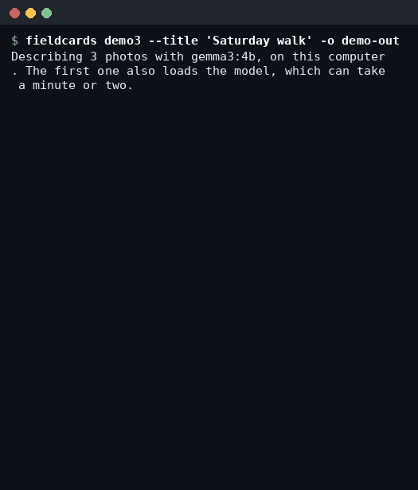
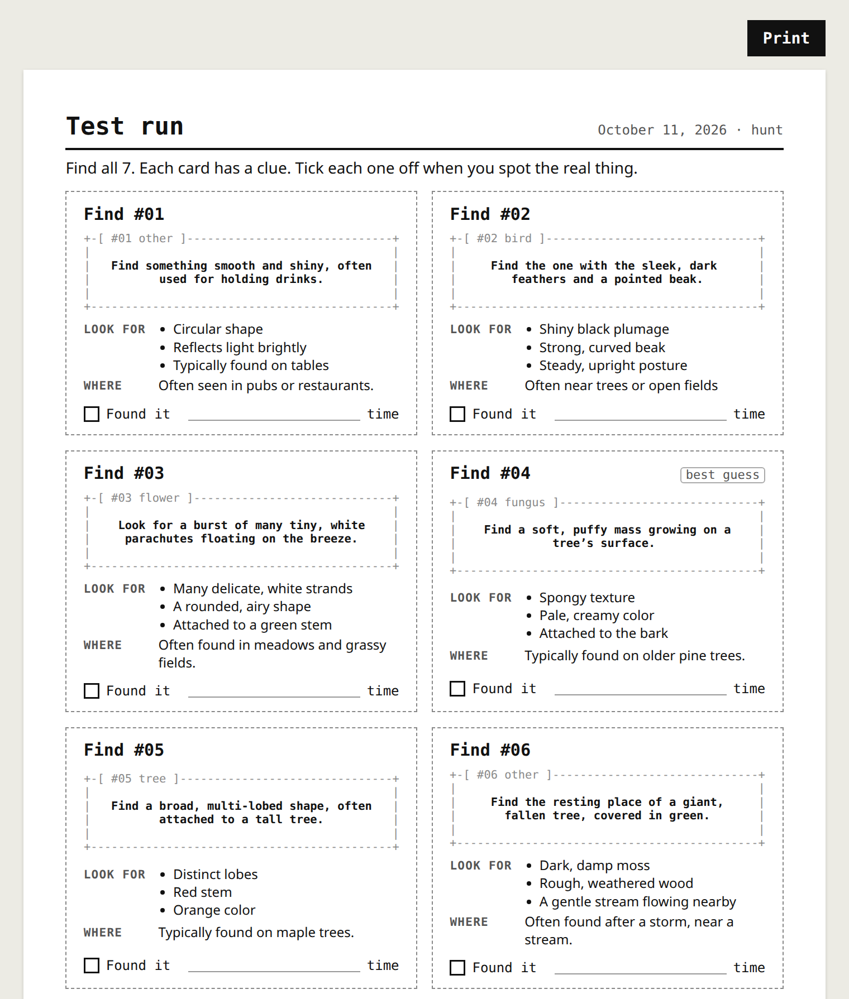

# fieldcards

Turn your outdoor photos into a printable scavenger hunt, with an open-weight model running on your own computer.

Each photo goes to **Gemma 3**, running locally through **Ollama**. Gemma works out what the photo shows and writes a clue for finding it that doesn't name it. Each clue is printed in a `+-[ #02 bird ]--+` frame, in the style of the [altsvg](https://www.npmjs.com/package/altsvg) alt-text placeholders. In a terminal, every card loads like the altsvg hero: shimmering noise and a scan line while Gemma reads the photo, then the noise dissolves into the card.

 You print the sheet, leave your phone at home, and go find the real things.

```
+-[ #05 other ]----------------+
|                              |
|    Find a dark, weathered    |
|    giant resting beside a    |
|   rushing, silver stream.    |
|                              |
+------------------------------+
- Green moss covering its
  surface
- Dark, grey wood
- A smooth, water-worn edge
Where: Typically found in damp,
       shaded forest streams.
[ ] found it   time: ______
```

That card came from a real `gemma3:4b` run on a photo of a mossy log across a forest waterfall.

With `--art photo`, cards print the photo itself in characters instead. It works best on simple subjects against a plain background, like this crow from the same run:

```
+-[ #01 bird ]---------------------------------+
|..     .     .....:..:::::----------- .:---:::|
|::::.........::..:::::::-====---::::-: :::::::|
|::::::::::::::::::::::-##%%%##*=:::::=. ::::::|
|....::::::::::::::::=*%@#**##-:::::::+=-:.  ..|
|:::::::::::::::::-=*#%####**=::::::::::=+-.:::|
|.:::::::::::::.:+%%%#*++*#%%+:::..:::::.::-+*+|
|...::::::::::.=#@@%%#**+**##+=-::-----::::::::|
|-::..::::::-+%@@@%%%%%#*+#%=---:::::::::::::::|
|:::--:.:::=@@%%@@@%@%%###*=---::::::::::::::::|
|::::::--=+%%@@@%%%@@%#*+--::::::::::::::::::::|
|.:::::-*%#**#%%#*###+-::::::::::::::::::::::::|
|....=#%*=::-#%+*%%%#-::::::::::.............::|
|.:::---:::-*%=:::-+*+=--:::::::::::::::::::::.|
|:::::::::-#%=::::::-==++:::::::::::::::::::...|
+----------------------------------------------+
A SLEEK, DARK BIRD
A large, glossy black bird perches on a
weathered branch.
- Dark, glossy feathers
- A strong, curved beak
- Alert, watchful posture
Where: Often found near trees and water sources.
[ ] found it   time: ______
```

## Why it runs locally

- **No signal needed.** The model runs on your laptop, so you can make cards at a cabin, a campsite or a field station.
- **Your photos stay yours.** Photos carry faces, home addresses in the background, and GPS in their metadata. Nothing is uploaded; the only request goes to `localhost`.
- **Free to run.** No API key and no per-photo cost, so a teacher can make a sheet for every class.
- **Swappable.** `--model` takes any vision model Ollama can run, and the JSON schema keeps the output in the same shape.

## Quick start

You need Node.js 18.3 or later and [Ollama](https://ollama.com).

```bash
# 1. Get the model (about 3.3 GB, once)
ollama pull gemma3:4b

# 2. Install the fieldcards command
npm install -g github:KunalSiyag/fieldcards

# 3. Point it at a folder of photos
fieldcards ./photos --title "Saturday in the park"
```

Then open `fieldcards-out/index.html` in a browser and press Print.



To see the cards in the terminal instead, add `--stdout`. Progress messages go to stderr, so you can pipe the cards straight to a printer:

```bash
fieldcards ./photos --mode guide --stdout
fieldcards ./photos --stdout --cols 32 | lp     # 58 mm receipt printer
```

Working from a clone instead:

```bash
git clone https://github.com/KunalSiyag/fieldcards && cd fieldcards
npm install            # also builds
node dist/cli.js ./photos
```

## What you get

| File         | What it is                                                                  |
| ------------ | --------------------------------------------------------------------------- |
| `index.html` | A print-ready sheet: six cards per page, with an answer key on its own page |
| `cards.txt`  | The same cards as plain text. Use `--cols 32` for a 58 mm receipt printer   |
| `deck.json`  | Everything Gemma said. Fix any mistakes, then reprint with `--from`         |

Two modes:

- `--mode hunt` (the default): a drawing, a clue and what to look for. The names are on a separate answer page.
- `--mode guide`: a drawing, the name and a description, like a pocket field guide for a walk you've already done.

`--art` sets what each card shows:

- `clue` (the default): the clue in its ASCII frame.
- `drawing`: Gemma also draws what it saw. A second, text-only request asks the model for the subject as named shapes on a small canvas, which fieldcards renders as ASCII line art. Nothing is pre-drawn, so the doodle always matches the description, but a 4B model draws crudely, and it adds about 25 seconds per photo. Use `--draw-model` to try a bigger model.
- `photo`: the photo itself converted to characters. Works best on simple, high-contrast subjects.
- `hint`: a small, blurry version of the photo beside the clue, for a harder hunt.

Photo art works with JPEG and PNG, and follows the camera's rotation tag, so portrait phone photos come out the right way up.

## Options

```
fieldcards <photos or folders...> [options]
fieldcards --from <deck.json> [options]

  -o, --out <dir>      Output folder (default ./fieldcards-out)
  -t, --title <text>   Title printed on the sheet
  -m, --mode <mode>    hunt or guide (default hunt)
      --model <name>   Ollama model (default gemma3:4b)
      --host <url>     Ollama server (default http://localhost:11434)
      --paper <size>   a4 or letter (default a4)
      --cols <n>       Width of cards.txt in characters (default 48)
      --from <file>    Reprint a deck.json without running the model
      --stdout         Also print the text cards to the terminal
      --art <style>    clue (default), drawing, photo or hint
      --draw-model <m> Model for --art drawing (default: --model)
      --no-anim        Plain progress lines instead of animated cards
```

Photos that have already been described are skipped on the next run. They are matched by content hash, so you can add photos to the folder and run it again.

## How it works

1. **Describe.** Each photo is sent to `POST /api/chat` on the local Ollama server, with a JSON schema in `format`. The model must return `subject`, `category`, `description`, `clue`, `look_for`, `where` and `confidence`.
2. **Check.** The answer is validated and trimmed. If a clue contains its own answer, the answer is blanked out, and low-confidence answers are marked "best guess" on the card.
3. **Print.** Each card is one grid of characters: the frame, the clue (and, with `--art drawing`, Gemma's doodle). The same grid is drawn as SVG for the printed page, as plain text for `cards.txt`, and animated in the terminal, so all three match. Text is wrapped and measured with altsvg.
4. **Animate.** In an interactive terminal, the card frame fills with noise and a scan line while the model works, then dissolves into the finished card, like the altsvg hero. It's drawn on stderr, skipped in pipes and CI, and turned off with `--no-anim`.
5. **Print the photo.** The photo is decoded locally, rotated by its EXIF tag, and averaged into character cells, then mapped onto ` .:-=+*#%@` so dark areas come out as dense ink. Tall photos are cropped to a square around the middle; printed narrow, each character would average a strip wider than a tree trunk. Mostly dark photos, like a forest in shade, would print as solid ink, so their midtones are lifted and mixed with histogram equalisation to bring out shapes. Light photos are left alone, which keeps plain backgrounds clean. The art is stored in `deck.json` at 96 columns and resized for each layout.

## What a 4B model gets right and wrong

In testing, Gemma 3 4B reliably recognised common things (a dandelion clock, a maple leaf, a waterfall) and wrote clues that don't give the answer away. It was weaker on specifics: a crow came back as "a sleek, dark bird", and a soft pine pollen cone was described as "woody". Its own confidence rating is only a rough signal. That's why every answer lands in `deck.json`, where you can fix it before printing, and why low-confidence cards say "best guess".

## Safety

Model output can be wrong. The cards are for looking, not for picking, touching or eating. Every sheet says so.

## Credits

- [Gemma 3](https://ai.google.dev/gemma) by Google, an open-weight model, run locally with [Ollama](https://ollama.com).
- [altsvg](https://www.npmjs.com/package/altsvg) draws the ASCII cards. It's my earlier open-source project, started in March 2026. Its ASCII style was added this week for fieldcards.

## License

ISC
